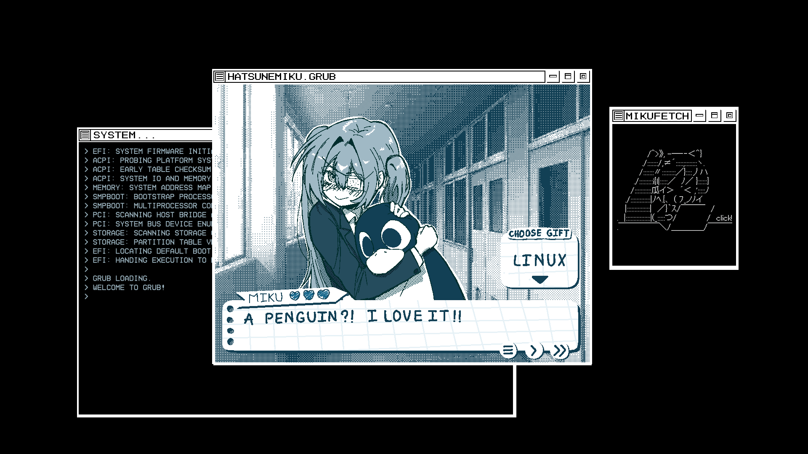

# Miku Dating Sim GRUB Theme

A Hatsune Miku–themed GRUB theme, remixed from the [Matrix Morpheus GRUB Theme](https://github.com/Priyank-Adhav/Matrix-Morpheus-GRUB-Theme). Art by me.



The original art files with layers can be found [here](https://www.mediafire.com/folder/xiafgyzxbnefz/MIKU_SIM) (clip  and psd included).
If you make something out of this, be sure to credit me (and send it to me too, I'd love to see it). Thanks!

---

**Note:**
- The install script should handle most of the work.
- There are only two images. One for Linux and one for Windows. Other options like "Advanced options" or "Snapshots" will display nothing (black screen).
- Reorder your boot options so that Linux is right above Windows to match the drawings. Other options can be hidden left in an order that you can remember.
- If you really need to use advanced options like "Snapshots", you can add a line in your grub.cfg to switch to another them when you enter the submenu. (kind of advanced so figure it out yourself lol)

## Installation

1. Clone the repo

```shell
git clone https://github.com/Thang1191/Miku-Dating-Sim-GRUB-Theme
```

2. Go into the folder

```shell
cd Miku-Dating-Sim-GRUB-Theme
```

3. Make the installer executable

```shell
chmod +x install.sh
```

4. Execute the installation script as admin

```shell
sudo ./install.sh
```

5. Reboot to test your new theme

## Manual installation

```shell
sudo cp -r Miku-Dating-Sim /boot/grub/themes/
```

Then add to `/etc/default/grub` (or replace the existing `GRUB_THEME=` line):

```shell
GRUB_THEME="/boot/grub/themes/Miku-Dating-Sim/theme.txt"
```

And regenerate the GRUB config:

```shell
sudo grub-mkconfig -o /boot/grub/grub.cfg
```

## Uninstall

```shell
sudo rm -rf /boot/grub/themes/Miku-Dating-Sim
```

Remove the `GRUB_THEME=` line from `/etc/default/grub`, then regenerate:

```shell
sudo grub-mkconfig -o /boot/grub/grub.cfg
```

> The installer saves a copy of `/etc/default/grub` as a `.bak.<timestamp>` file next to it before making changes (the path is shown at the end of the install). To fully restore your previous config, copy it back before removing the `GRUB_THEME=` line.
